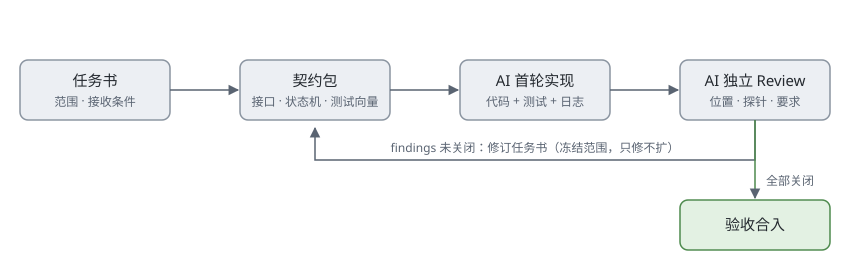

## 背景

最近一轮固件模块重构（协议通道 / 编解码 / 应用框架）尝试了 AI 深度参与的协作方式：AI 既当实现者，也当独立的验收审查者。一个模块从任务书出发，经过多轮"实现—审查"循环，首轮 Review 打回了十项 P1 级 findings——而这些恰好是常规自测"全绿"所掩盖的问题。

这篇文章沉淀这套流程：契约怎么写、Review 怎么做、哪些教训具有通用性。

## 角色分工：实现与审查必须分开

最有效的结构是把两个 AI 角色当作**互为对手盘**的两方：

- **实现者**：按任务书交付代码与测试，不参与验收判断；
- **审查者**：只依据契约与代码做独立检查，不共享实现过程的"自我辩护"，专门构造让实现失败的输入；
- **验收人（人）**：持有最终判断，决定 findings 是否构成阻断、下一轮范围是否放行。

审查者不带实现者的上下文，这一点很关键——它逼着实现者把"为什么这样写"固化到代码与文档里，而不是留在对话记忆里。

## 契约先行：把"规格"变成数据

任务书之前先有契约包，至少包含：

- 接口签名与语义（含错误码、边界条件）
- 状态机与生命周期（谁能创建、谁负责退休、终态可否复用）
- 资源预算（flash/RAM/PCB/栈），并约定**未测量的指标只能标 NOT_MEASURED**
- 共享测试向量（JSON 等规格数据）

其中测试向量是这套方法的核心：**向量属于规格，实现侧不允许删除或放松不通过的项**。这从机制上封死了"改测试凑实现"的路径——契约错了可以改契约，但要留下记录；实现错了只能改实现。

## 任务书的要素

一份可执行的任务书要回答三个问题：

1. **改动范围**：允许动哪些文件，哪些独占（避免并行任务互相踩）；
2. **接收条件**：可执行的验收标准，而不是"把稳定性做好"这类口号；
3. **交付物**：独立 commit、原始日志、case ID 状态表，缺一项就退回。

## Review 的形态：finding 三要素

每条 finding 固定为三段：

- **位置**：`文件:行号`，可直达；
- **复现探针**：一段最小代码或命令，跑起来就能看到错误行为；
- **要求**：期望的行为，与契约条款对应。

分级只用两档：P1 阻断（不修不能进下一阶段）、P2 改善。修订轮**冻结范围**——只关闭已有 findings，不掺新特性，防止边修边漏。

## 五条通用教训

1. **未执行的测试不能计 PASS。** SKIP / FAIL / PASS 分开计数。"25/25 通过"里若混着几条根本没跑的，整份报告不可信。
2. **没测量的指标写 NOT_MEASURED。** 不能从 map 文件或构建报告反推"满足资源预算"。
3. **异常退出不是"拒绝通过"。** crash、超时、内部异常一律算 FAIL；只有预定义的拒绝码才算通过。否则越界和解析崩溃都会被包装成"验证通过"。
4. **修改测试期望去迎合实现是反模式。** 测试失败先问是契约错还是实现错，两边都可能错，但选择要留痕。
5. **第一轮 findings 没关闭前，不进新特性。** 范围蔓延是修订质量的最大敌人。

## 小结

AI 把"写代码"的成本大幅压低之后，研发瓶颈整体移到了**验收**这一侧：能不能定义出可执行的契约，能不能构造出让实现露馅的探针，决定了协作质量的上限。

这套流程还有一个副产品：每轮任务书与 review 文档天然构成了设计文档与验收记录——事后回溯"当时为什么这么定"时，依据都在。

如果读者也在用 AI 做嵌入式或系统级开发，欢迎交流各自的契约与验收实践。
