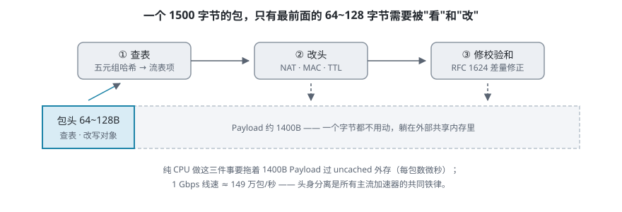
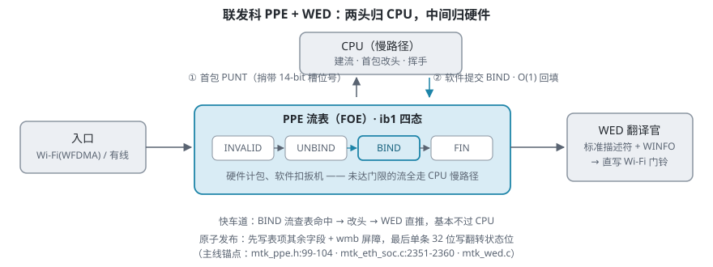
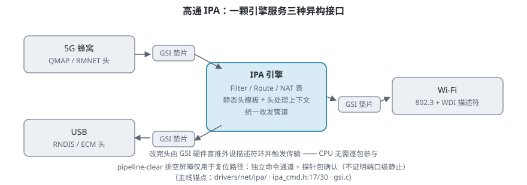
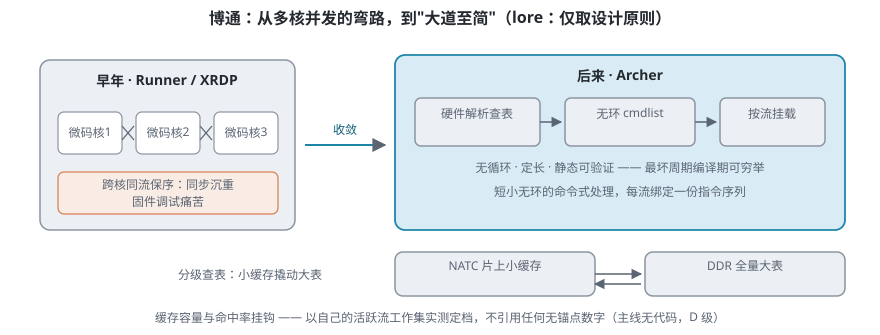
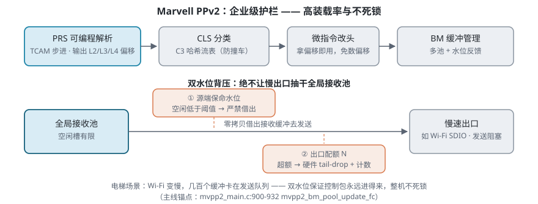

> 本文源自一次自研轻量 NAT 加速器立项前的架构调研，聚焦一个问题的答案：**"只把包头抓进小引擎跑一段短微码，让 1500 字节的 Payload 躺在外部内存里不动——这套路子在工业界靠谱吗？"** 答案是：五大芯片巨头的演化方向惊人一致。文中每条机制标注证据等级（A=主线/vendor 代码级，B=厂商手册层，C=设计推断，D=社区 lore），不带代码锚点的数字一律不采信。

## 所有加速器面对的同一个难题

无论是家用路由器、PON 光猫还是 5G MiFi，每个包过路只干三件事：

1. **看包头（前 54~64 字节）**：五元组查表，认识不认识；
2. **改几个字节**：NAT 转换、换 MAC、TTL 减 1；
3. **修校验和**：按 RFC 1624 差量公式修正 IPv4/TCP/UDP 校验和。

而纯 CPU 转发卡死的原因很朴素：**一包 1500 字节，真正要看的、要改的只有最前面 50~64 字节**，后面 1400 多字节的 Payload 一个字节都不用动。在缺少硬件 Cache 一致性、包缓冲映射在 Non-Cached 外部内存的嵌入式 SoC 上，CPU 若把整个 Payload 读一遍重算校验和，光等外存就要数微秒——1 Gbps 线速（每秒 149 万个小包）瞬间把 CPU 烧穿。

于是行业收敛出一条铁律——**头身分离**：

> **1400 字节的身体躺在外部共享内存里一步不动；只把最前面 64~128 字节的头抓进加速器内部的小内存，闪电改完再贴回去。**

围绕这条铁律，五家厂商各自演化出了独门绝技。

## 东邪 · MediaTek：HNAT/PPE + WED —— 克制到极致的实用主义

代表作 MT7621、Filogic MT7981/7986/7988（OpenWrt 与运营商路由器主力）。主线源码：`drivers/net/ethernet/mediatek/mtk_ppe.c`、`mtk_wed.c`。

**理念：两头归 CPU，中间归硬件。** 一条连接的生命周期分三段——建立（握手/首包）、稳定传输、关闭（FIN/RST）。让硬件处理建流、端口分配或挥手状态机，逻辑复杂十倍。MTK 像 ETC 车道：只放行已办卡正常行驶的车（稳态流），办卡和销户全走人工车道（CPU）。

**绝技（均为主线代码级）：**

1. **`ib1` 四态状态机 + 延迟绑定，根治首包超车乱序**。新流首包命中 `UNBIND` 空项时，硬件只做学习与计数（`mtk_ppe.h:99-104`，`MTK_FOE_IB1_STATE`）；达到绑定速率门限（默认 BIND=30 包）后，以 PUNT 原因码 `HIT_UNBIND_RATE_REACHED=0x0f` 通知驱动，**由软件经 `__mtk_foe_entry_commit()` 写入 `BIND`**——"硬件计包、软件扣扳机"，前几个包全走 CPU 慢路径，从物理时间上消灭"第 2 包硬件超车第 1 包软件"的乱序。
2. **两阶段单字原子发布**。表项 80~128 字节（主线 V1/V2/V3 三代），32 位总线要写十几次；驱动先写其余字段（此时状态位非 BIND），插 `wmb()` 屏障，**最后用单条 32 位写翻转状态位**——硬件要么看不见，看见必是完整表项。
3. **PUNT 捎带哈希索引**。包上送 CPU 时，RX 描述符第 4 字携带 14-bit 流表槽位号与原因码（`mtk_eth_soc.c:2351-2360`），CPU 建完流不用重算哈希，O(1) 回填表项。
4. **WED 无线翻译官**。Wi-Fi 私有描述符 PPE 不认识，WED 作为极薄硬件翻译层把标准描述符 + 32 位 `WINFO`（站点号/队列号）翻译成 Wi-Fi 描述符直写门铃，让 5G/有线 ↔ Wi-Fi 转发基本不过 CPU。

⚠️ 待证一条："TCP FIN 命中自动降级表项"在主线只看到 FIN 读取与老化配置，没有命中即降级的代码路径——属厂商手册层表述（B 级）。

## 西毒 · Qualcomm：IPA —— 为 5G MiFi 量身定做

代表作 Snapdragon X55/X65/X75（全球多数高端 5G CPE 与 MiFi 的心脏）。主线源码：`drivers/net/ipa/`。

**理念：统一 GSI 管道 + 查表 + 头部处理上下文，应对多协议异构封装。** 5G 蜂窝吐 `QMAP/RMNET` 头，USB 要 `RNDIS/ECM` 头，Wi-Fi 要 `802.3 + WDI` 头——IPA 的任务就是让同一颗引擎服务这三端。

**绝技：**

1. **GSI 硬件门铃直通车**【A 级，`gsi.c`】：外围通过 GSI 薄垫片接管 USB 的 TRB 描述符环与 Wi-Fi 的 WDI 通道，改完包头硬件直接推进外设环，CPU 无需逐包参与。
2. **pipeline-clear 排空屏障**【A 级机制，但语义有边界】：复位时用独立命令通道下发清空命令，再靠一个探针包走完整条流水线作为"排空完成"信号。注意：主线**只在复位路径**用它——pipeline-clear 只证明"引擎内已排空"，不证明"已提交到端口 TX 环的包已离场"，不能当日常流表失效的屏障。
3. **静态头模板 + 动态处理上下文**【B 级，手册层】：把固定不变的头字节与逐包计算的字段分开存放——固定部分查模板表，可变部分跑一小段处理序列。

## 南帝 · NXP：PPFE —— 微码加速器的嫡系鼻祖

代表作 Layerscape LS1012A（源自 Mindspeed Comcerto C2000）。注意：Linux **主线没有**该驱动，位于 NXP vendor 内核 `nxp-qoriq/linux` 的 `drivers/staging/fsl_ppfe/`（B 级）。

**理念：最纯粹的头窗微码机。** 完整报文由 BMU 缓冲管理器存进外部 DDR 缓冲池；只把包头窗口 DMA 进 Class PE 本地内存，微码固件（`class_fw.elf`）改写后**只刷回改动的首部字节**，Payload 纹丝不动。

**最值得借鉴的一点：头长会变。** 不同出口需要的私有头长度不一样——USB RNDIS 前置十几个字节、Wi-Fi TX 前置更长的私有头，未来加 VLAN/PPPoE 还会变。若引擎只会"原位置写回"，头长一变软件就得 `memmove` 整包搬移，加速全白干。解法是在缓冲区预留头部空间，包头窗内伸缩后**按新起点写回并同步更新描述符的偏移与长度**——Payload 一字节不搬。我们把这个思路内化为"带符号偏移的写回"（自命名，机制方向参考 NXP 手册对头窗/缓冲预留的用法）。

## 北丐 · Broadcom：Runner & Archer —— 弯路归来，大道至简

代表作 BCM4908/6858（Runner/XRDP）、BCM6756/63178（Archer）。**声明：主线与 OpenWrt 树均无任何 Runner/Archer 代码，本派全部内容属私有 SDK/社区逆向（D 级 lore），只取机制方向，不引用任何数字。**

**演进路线本身就是活教材：**

- **早年 Runner/XRDP**：多个通用微码小核并发跑包。跨核的同流保序需要沉重的同步调度，固件调试痛苦——多核并发不是免费的。
- **后来 Archer**：收敛到"硬件解析查表 + 短小无环的命令式处理"。

**两条设计原则（不依赖细节成立）：**

1. **每流挂载定长无环命令序列**：无循环、定长、静态可验证、按流绑定——微码有没有死循环、最坏多少拍，编译期就能穷举证明。
2. **分级流表：片上小缓存撬动片外大表**：全量流表放 DDR，片上只留一个小缓存。命中率与缓存容量直接挂钩，且"大象流命中率"与"长尾连接数"是两个量纲（UDP 短命流会冲刷缓存）——这类指标必须用自己的工作集实测，不能抄别人数字。

## 中神通 · Marvell：PPv2 —— 企业级护栏

代表作 Armada 3700/7040/8040/CN9130。主线源码：`drivers/net/ethernet/marvell/mvpp2/`。

**理念：严谨工整，讲究高装载率与极端拥塞下系统不死锁。** 流水线：PRS 解析 → CLS 分类查表 → 微指令改头 → BM 缓冲管理。

**绝技：**

1. **PRS 可编程解析器把偏移前移**【A 级，`mvpp2_prs.c` TCAM 步进解析】：以太网包前可能有 0~2 个 VLAN、PPPoE 头，让下游引擎自己数偏移既费指令又易错——解析层直接输出 L2/L3/L4 偏移，下游微码拿来就用。
2. **C3 哈希流表**【引擎 A 级；布谷鸟/装载率细节为文档层待证】：单桶哈希的生日悖论是真实痛点——装载 30% 就频繁撞车。启示：哈希选型以"目标装载率下的 miss/PUNT 率"为验收指标实测，不引未经证实的数字。
3. **BM 双水位背压，绝不让慢出口抽干全局接收池**【A 级，`mvpp2_main.c:900-932`】：设想 5G 口 1 Gbps 猛收包，零拷贝把接收缓冲借给 Wi-Fi 口发送；手机进了电梯，Wi-Fi 变慢，几百个缓冲全卡在发送队列还不同来——几毫秒后全局接收池被抽干，连控制包都收不进来，整机死锁。Marvell 的解法是两道硬件水位红线：**源端保命水位**（空闲低于阈值时严禁零拷贝借出缓冲）+ **出口配额**（每个出口最多挂 N 个未完成包，超额硬件 tail-drop 并计数）。

## 证据分级：这篇调研的工作方法

全文机制声明按四级标注，评审时逐条核对：

| 等级 | 含义 | 要求 |
|---|---|---|
| A | 主线/vendor 代码级 | 必须给出 `文件:行号`，逐条核对 |
| B | 厂商文档/SDK 级 | 方向可信，细节无代码锚点，显式降级引用 |
| C | 我方推断/自命名抽象 | 不作为厂商既有事实表述 |
| D | lore（私有 SDK/社区逆向） | 只取设计原则，不引用数字 |

这套分级让交叉评审抓出了十余处过强表述（虚构的函数名、查无实据的机制、无锚点的命中率数字），方法细节见姊妹篇《[AI 交叉评审实战](/ai/ai-evidence-grading-review/)》。

## 结语：范式收敛

五大厂商交过无数次流片学费后收敛出的核心范式高度一致：**头窗微码引擎 + 流表 + 端口适配器**，外加延迟绑定、原子发布、分级表、双水位这些"工程死角"的通用解法。我们在自研轻量 NAT 加速器的方案收敛中得到了同样的结论，具体取舍见姊妹篇《[轻量嵌入式 NAT 加速的八个设计原则](/network/nat-offload-design-principles/)》与《[RTL 之前先把风险拆掉](/network/datapath-verify-ladder/)》。

**参考（公开主线/vendor 源码）**：`drivers/net/ethernet/mediatek/`（mtk_ppe.c / mtk_wed.c / mtk_eth_soc.c）、`drivers/net/ipa/`（ipa_cmd.c / gsi.c）、`nxp-qoriq/linux` vendor 树 `drivers/staging/fsl_ppfe/`、`drivers/net/ethernet/marvell/mvpp2/`（mvpp2_prs.c / mvpp2_cls.c / mvpp2_main.c）
