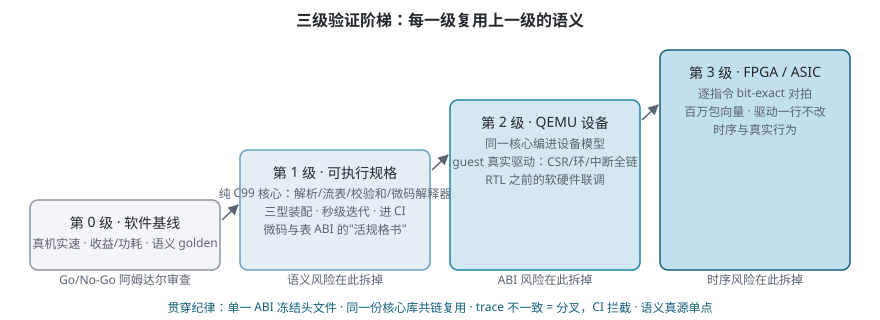

> 做硬件加速，最贵的错误不是面积超标，而是**语义错误**——RTL 回片后才发现查表/改写/屏障行为与软件预期对不上，一次流片学费就够买整个验证团队。更常见的翻车姿势是"模拟一套、RTL 一套、对拍不上"。这篇讲我们在自研轻量 NAT 加速器立项中搭的三级验证阶梯，以及贯穿始终的一条纪律。

## 第 0 级：真机软件基线（零硬件成本，兼作 Go/No-Go 铁门槛）

在动任何 RTL 之前，先在现有芯片上用纯软件改造拿两类数据：

- **收益/功耗基线**：把现网软件快路径的校验和改成 RFC 1624 增量修正、加上遥测计数，跑真实流量测 CPU 占用与电流分布；
- **产品语义 golden**：现网软件的 NAT 行为（TTL、分片、UDP 源端口双零等边界）就是未来硬件必须 bit-exact 对齐的规格。

这一步还有个容易被跳过的作用——**阿姆达尔审查**：如果实测发现残余的整包 memcpy 与 padding 拷贝仍占大头，加速器把查表改写做到零纳秒也救不回来，硬件 Go/No-Go 就该 No。一两周的软件实测，挡掉的是几百万级的流片风险。

## 第 1 级：可执行规格——微码与表 ABI 的"活的规格书"

把 NAT 语义从现网代码中抽离成一份**纯 C99、无 OS 依赖的核心库**：解析/预筛、流表（含两阶段发布）、增量校验和、微码解释器、遥测。它不是"模拟器"那么简单，而是**微码指令集与表项 ABI 的可执行规格**——文档会撒谎，能跑的代码不会。

三个关键纪律：

1. **单一 ABI 冻结物**：流表位域、描述符格式、CSR 布局、PUNT 语义全部集中在一个头文件里，软件侧与硬件侧都从它生成/引用，谁也不许私改；
2. **参数化装配**：同一核心按编译开关装配出三种形态——纯软件快路径（验证"少硬化"基线）、单实例微码引擎（主体方案）、多实例演进型——用同一套用例回归，证明演进不锁死；
3. **进 CI 秒级迭代**：自测入口一键跑三型 smoke，改一行语义立即见红绿。

## 第 2 级：QEMU 设备——RTL 之前的软硬件联调

有了核心库，把它**同一个 `process_one()` 函数**编译进 QEMU 的自定义设备模型，挂到目标 SoC 的虚拟机器上：guest 固件里的**真实驱动**按 ABI 写 CSR、投描述符环、收中断，设备侧查表改写后把头窗写回 guest 内存——收发/PUNT 全链在 QEMU 里闭环。

这一级回答的问题与第 1 级不同：不是"语义对不对"，而是**"驱动与硬件的 ABI 约定对不对"**——寄存器时序、环的 valid 位协议、中断/轮询选择、地址图占位。这些问题等 FPGA 才暴露，成本已翻了几番。

**防分叉机制**：QEMU 设备与主机模拟器必须共用同一份核心代码（静态库共链），并要求两者的执行 trace 逐包一致——不一致就是 core 被分叉，CI 直接拦截。语义修改只允许发生在真源一处，副本修改必须先改真源再同步。

## 第 3 级：FPGA / 流片前对拍

RTL 到位后，前面每一级都自动变成**对拍基准**：

- 微码解释器 ↔ RTL 逐指令 bit-exact（百万包向量）；
- 软件基线的 NAT 语义 golden ↔ 硬件转发结果逐字段比对；
- QEMU 里跑通的同一份 guest 驱动**一行不改**直接上 FPGA，互为 golden。

## 边界：这套阶梯测不出什么

诚实地说清局限：可执行规格与 QEMU 设备都是**功能级模型**，测不出时序类缺陷——竞争、握手、亚稳态仍要靠 FPGA 实测与故障注入矩阵。另外几个容易漏的校准点：模拟器用的简化哈希必须与 RTL 的多项式校准为同一函数（否则 PUNT 回填索引的 O(1) 建流路径失效）；虚拟时钟与真实 SoC tick 的差异会影响老化行为，需要用 guest 可见计数器校正。

## 小结

| 级 | 载体 | 回答的问题 | 迭代速度 |
|---|---|---|---|
| 0 | 真机软件基线 | 值不值得做？产品语义长什么样？ | 真机实速 |
| 1 | 可执行规格 | 微码/表 ABI 语义对不对？ | 秒级，进 CI |
| 2 | QEMU 设备 | 驱动与硬件的 ABI 演练通不通？ | 接近实速 |
| 3 | FPGA/ASIC | 时序与真实行为 | — |

一句话：**让每一级复用上一级的语义，让每个语义只写一遍**。这套阶梯的成本是几周的软件工程，换来的是流片前把"语义、ABI、驱动"三类风险全部拆掉。

方法论之外，这次调研中 AI 交叉评审抓住的十余处事实错误同样值得记录，见《[AI 交叉评审实战](/ai/ai-evidence-grading-review/)》。
