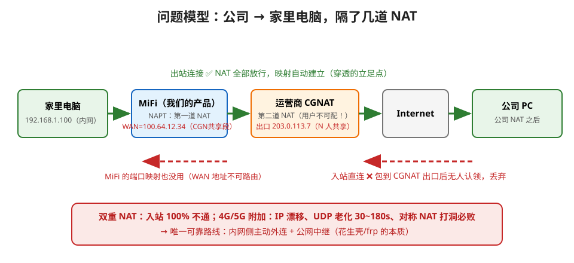

> 本文是《MiFi 内网穿透》系列第 1 篇：先建立问题模型，后续篇章再展开方案选型与落地实现。



## 1. 问题模型：为什么公网不能直接访问家里电脑

```text
家里电脑            MiFi                    运营商 CGNAT         Internet
192.168.1.100 → NAPT(WAN=100.64.12.34) → 出口203.0.113.7(共享)
```

MiFi 自身的端口映射只能处理第一层 NAT。若运营商没有提供入站映射，公网发起的未经协商的新连接没有完整转发路径。100.64.0.0/10 是 RFC 6598 共享地址空间，不能作为公网服务地址；蜂窝 WAN 也可能得到 RFC 1918 私网地址。

WAN 私网地址与 STUN 返回地址不同，说明路径上存在上游地址转换，**不能据此推断映射行为、过滤行为或 UDP 打洞必然失败**。加上 MiFi 的 NAPT，LAN 设备通常经历多层转换。公网出口变化、UDP 状态超时和运营商过滤还会影响已有连接，必须做保活与重连。

## 2. 分开测量映射、过滤和端口分配

RFC 4787 §4.1、§4.2.1、§5 分别描述映射行为、端口分配和过滤行为。传统 full cone / restricted cone / symmetric 名称容易混淆这些维度，工程实现按下表记录：

| 维度 | 行为 | 对打洞的影响 |
|---|---|---|
| 映射 | 端点无关 EIM：同一本地 ip:port 对不同远端复用外部映射 | STUN 候选更可能可复用；仍需检查过滤 |
| 映射 | 地址相关 ADM / 地址和端口相关 APDM | 对 STUN 的映射可能不适用于对端；简单交换 STUN 候选可能失败 |
| 过滤 | 端点无关 EIF / 地址相关 ADF / 地址和端口相关 APDF | 决定哪些远端可发送入站流量；相关过滤通常需要先向对端发包 |
| 端口分配 | 保留本地端口、顺序分配或随机分配 | 影响预测策略，但不能替代映射与过滤判定 |

"公网端口多次不变"不等于端口保留；端口保留指公网端口等于本地源端口，也不保证映射与远端无关。

测试映射时，保持**同一个本地 UDP socket**，向不同远端 IP 和端口发送 STUN 请求；测试过滤需要具备多地址响应能力的测试端，验证未被本地主动联系的来源能否进入。对同一 STUN 目标反复请求只能观察该映射的稳定性。多层 NAT 记录的是整条路径的组合行为，网络变化后需重新测量。

**基本打洞过程**：双方从同一个业务 UDP socket 获取候选，经认证信令交换，同时互发并确认双向连通。目的相关映射会降低成功率；能否通过预测或受限探测改善取决于具体组合，不能统一承诺"必败"或固定成功率。中继始终保留为兜底。

## 3. 三条技术路线对比

| 路线 | 代表 | 原理 | 在 4G/5G 下 | 代价 |
|---|---|---|---|---|
| P2P 打洞 | STUN/ICE、frp xtcp | 候选协商、双方出站探测并检查双向连通 | 需按运营商和两端组合实测 | 省中继带宽，但成功率无保证 |
| 中继 Relay | frp tcp/udp/stcp、rathole、自研 TLS 代理 | 内网设备主动连公网服务器，由服务器转发 | 不依赖上游入站映射；需出站协议可达 | VPS 带宽与运维成本、额外时延 |
| VPN 组网 | WireGuard hub、Tailscale/headscale、ZeroTier | 隧道地址与路由使设备互访 | WG hub 需要出站 UDP；TCP/HTTPS 封装是额外组件 | 访问端通常需客户端；LAN 路由与权限需单独配置 |

出站可达仍受防火墙和运营商策略约束。TCP 443 不等于 HTTPS，严格代理或协议检查环境需验证 TLS/HTTPS/WebSocket 等实际传输，不能只凭端口号保证通过。

## 4. 结合 freertos_bw 的选型

- 当前 `feat/wireguard-dev` 已有实验性 `wireguard-lwip` 集成；首版只开放 MiFi 本机 `10.0.0.3`，不开放 LAN 转发、不做 P2P 或 Ethernet 广播。
- 先完成本机 WG 板端互通及受控运维入口；需要访问下挂设备时，再增加路由、服务器 AllowedIPs、PC 路由及防火墙策略。
- 要求访问端免安装时，可考虑带访问者认证的应用代理；STCP 需要 visitor，WG 需要 VPN 客户端，均不能描述成"零安装"。
- UDP 被限制时再评估 TLS/HTTPS 隧道；打洞作为后续带宽优化，不作为首版可达承诺。

参考：[RFC 4787](https://www.rfc-editor.org/rfc/rfc4787.html)、[RFC 5780](https://www.rfc-editor.org/rfc/rfc5780.html)
