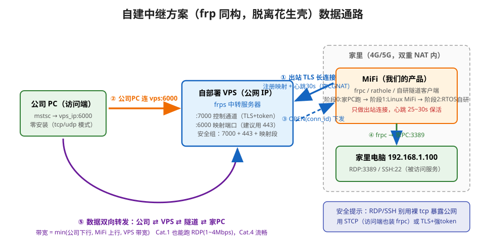

> 本文是《MiFi 内网穿透》系列第 2 篇：上一篇《[双重 NAT 问题模型](/network/dual-nat-traversal/)》建立了原理框架，本篇拆解商业方案、对比自建路线。



## 1. 花生壳（贝锐 Oray）是怎么工作的

花生壳本质 = **反向隧道 + 端口映射** 的商业中继服务，与开源 frp 同构：

1. 内网机器装花生壳客户端，**主动**与贝锐中转服务器建立加密长连接并保持心跳（不依赖上游入站映射，但仍要求出站协议可达）；
2. 客户端上报要映射的内网服务（如 `192.168.1.100:3389`）；
3. 贝锐分配公网访问地址（固定的 `域名:端口`，自动部署证书）；
4. 外部访问者连该地址 → 流量落到中转服务器 → 经隧道下发到内网客户端 → 客户端转给内网服务；
5. 商业化包装：实名认证、免费版限带宽/限映射数、按带宽收费。

**"脱离花生壳" = 自建第 1~3 步**：一台公网 VPS 当中转，内网侧跑一个开源客户端。

## 2. 方向问题：嵌入式设备侧才是难点

一个常见的认知错位：网上教程（如 4G 模块 + 花生壳）里，**4G 设备是 UDP 客户端主动外发**——这天然可行；难点在固定侧（PC 无公网），由花生壳解决。而嵌入式产品的场景**互为镜像**：要让 4G/5G 侧的设备**当服务端被访问**，所以中继客户端必须搭在 4G/5G 这一侧（MiFi 上）——这是更难、也更有产品价值的一侧：资源受限的 RTOS 上跑客户端，而不是 Linux PC。

## 3. 自建方案选型对比

| 方案 | 形态 | 协议 | 打洞 | 资源占用 | 评价 |
|---|---|---|---|---|---|
| **frp** | Go 单二进制 | TCP/UDP/HTTP/HTTPS/STCP/XTCP | XTCP（受限） | 中（RAM 数十 MB） | ✅ Linux 主线候选，生态最全 |
| **rathole** | Rust 单二进制 | TCP/UDP | 无 | **极小（MB 级）** | ✅ 低配设备首选 |
| nps | Go | TCP/UDP/HTTP/SOCKS5 | 有 | 中 | 原仓库停更，需用社区 fork |
| gost | Go | 多协议隧道 | — | 中 | 运维瑞士军刀，偏通用 |
| **WireGuard + VPS hub** | 内核/用户态 | L3 按 AllowedIPs 转发 | hub 模式无需 | 依实现实测 | 组网路线，需出站 UDP |
| Tailscale + headscale | Go | L3 + DERP 中继兜底 | 内置 | 中 | ✅ 体验最好的组网路线，控制面可自建 |
| ZeroTier | C++ | L2/L3 | 内置（moon） | 中 | moon ≠ 完整私有控制面 |

选型要点：RTOS 上不能直接跑 Linux 二进制——嵌入式侧要么走轻量中继客户端（rathole 量级），要么走组网路线的用户态 WireGuard；Linux 侧 frp 生态最全。

**合规注意**：境内 VPS 用域名提供 HTTP(S) 服务需 ICP 备案；纯 IP + 非标端口的 TCP/UDP 转发一般不需要。TCP 443 不等于 HTTPS——严格协议识别环境要实测 TLS/WebSocket 实际支持。

## 4. frp 工作机制（中继路线的参考实现）

```text
              ①控制长连接(TLS+token, 心跳30s)   ②RDP连接
家MiFi:frpc ────────────────────────────────→ VPS:frps ←─────────── 公司PC:mstsc
   │              注册映射: remote 6000 → 192.168.1.100:3389   (连 vps:6000)
   │←───────────── ③"新用户连接 conn_id=xx"（经控制通道下发）
   └─④ 连家PC:3389, 两段连接在 frps 处 splice → ⑤数据双向转发
```

几个值得抄的设计：

- **控制连接**：客户端 → 服务器持久 TCP（TLS + token 认证），注册代理配置——与花生壳心跳同构；
- **心跳保活**：默认 30s 一跳（90s 超时），维持 CGNAT 映射不被回收——保活周期必须短于运营商 NAT 的 UDP 状态超时；
- **STCP 安全模式**：不暴露公网端口，访问端也跑一个 visitor 凭 secret 连接，适合 RDP/SSH 这类怕爆破的服务；
- **XTCP 打洞**：借助 STUN 尝试直连省服务器带宽；目的相关映射/过滤组合可能失败，**回落能力必须用阻断直连的实验验收**，不能凭文档描述下结论；
- 断线重连：内置指数退避，网络切换（4G 重附着）后自动恢复。

## 5. 小结

商业穿透服务没有魔法——拆开就是"反向隧道 + 端口映射 + 心跳保活"，全部技术点开源世界都有对应物。自建的核心决策只有两个：**哪一侧跑客户端**（嵌入式侧是硬约束）与 **中继还是组网**（frp/rathole vs WireGuard/Tailscale）。相关阅读：《[Tailscale 的 NAT 穿透是怎么做的](/network/tailscale-nat-traversal/)》《[NAT 动画演示](/network/nat-animation-demo/)》。
